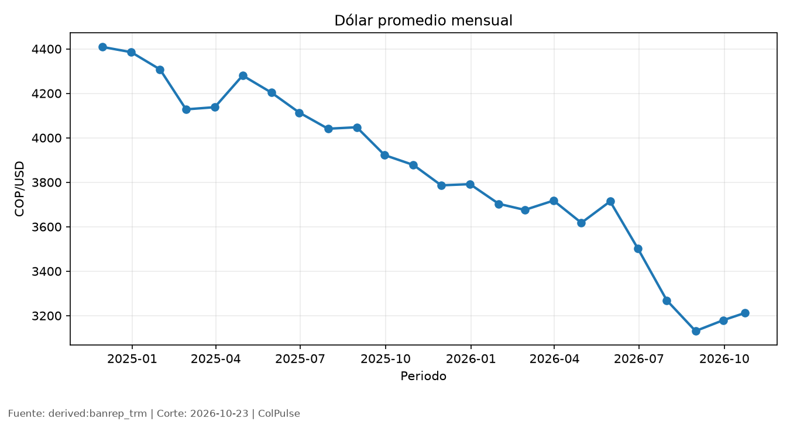

# ColPulse | Radiografia de 2026-10

**Executive summary**
El monitor consolida 50 indicadores oficiales y derivados (Colombia y contexto externo) con datos disponibles hasta 2026-10-30. La base combina series de precios, actividad, mercado laboral, sector externo, condiciones financieras y mercados. La lectura ejecutiva debe distinguir hechos observados, inferencias razonables e hipótesis pendientes de validación; ningún resultado modelado se presenta como dato oficial.

## Insights clave

### Insight 1
El dólar subió: se ubicó en 3,167 pesos por dólar en el corte 2026-10-30, con un cambio de 5 pesos por dólar frente al dato anterior (2026-10-29).

### Insight 2
La tasa de política monetaria se mantuvo estable: se ubicó en 12.25% en el corte 2026-10-30, con un cambio de 0.00% frente al dato anterior (2026-10-29).

### Insight 3
El COLCAP subió: se ubicó en 2,560.61 puntos en el corte 2026-09-01, con un cambio de 123.67 puntos frente al dato anterior (2026-08-01).

## Grafico principal

## Estado de datos
La trazabilidad de esta corrida queda en [data_health.md](data_health.md). Los indicadores con estado no publicable no se usan para conclusiones ejecutivas.

**Dato de cierre:** El proximo corte debe vigilar frescura de fuentes y revisiones oficiales.
